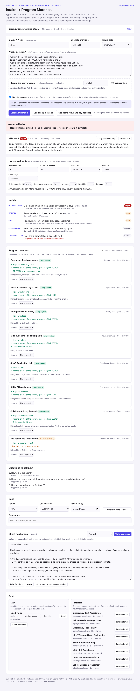
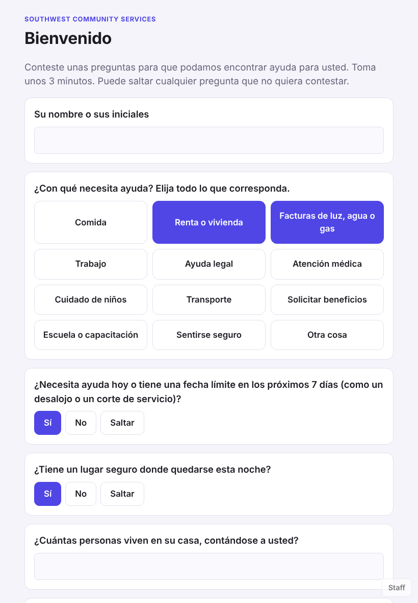

# Nonprofit Intake Screener

A web tool for the first conversation with a client. Staff type, paste or record what the client shares, in any language. Claude pulls out the facts, then **the page checks those facts against the organization's own program rules** and shows exactly why each program fits or doesn't, what to ask next, what's urgent, and the client's next steps in their own language.

**Live demo: [mykel23.github.io/nonprofit-intake-screener](https://mykel23.github.io/nonprofit-intake-screener/)** (click "See demo result", no API key needed)

## Why I built this

Intake is where small nonprofits lose people. A client describes five problems at once, often in a second language. The staff member has to remember which of a dozen programs might help, what each one's income limit and service area is, and what documents to ask for. Urgent problems like an eviction in five days can sit in a queue behind routine ones. And when no program fits a need, it usually isn't written down anywhere, so the organization never learns where its gaps are.

I built a tool that does that first pass consistently, keeps a person in charge of every decision, and records the gaps.

## What it does

**Capture the intake**
- **Client self-intake mode** for a tablet in the waiting room: big buttons, in English, Spanish, Vietnamese or Chinese. Clients pick what they need help with, answer short household questions (each can be skipped), and can speak their note instead of typing. Answers are saved as structured facts, so eligibility runs immediately, even without an API key. Staff then review with the client, and Claude can read the client's note in their language to fill in deadlines and details. A "no safe place tonight" answer shows 911 to the client right away and flags the intake for staff. An optional PIN keeps clients from leaving the tablet screen. Open it from the header, or with `?kiosk=1` in the link.
- **Returning clients are recognized by ID.** Staff see their past intakes and can add the last visit as context. Results show **what changed since last time** (income, household size, ZIP, new needs, and needs that still aren't solved), along with every past referral and its outcome.
- Type or paste notes, or **record the conversation**. Speech-to-text works in English, Spanish, Vietnamese, Mandarin, Arabic and more, and Claude reads any language.
- A consent checkbox, plus guidance to use an ID or initials instead of a name and to skip Social Security numbers, immigration status and medical details. Claude is told never to record them.

**Screen it**
- Claude extracts household size, income, ZIP code, age, household details (children, seniors, veterans, disability, pregnancy) and each need with its urgency and deadline.
- **Every eligibility decision is made by the page,** from rules the organization sets for each program: income as a % of the 2026 federal poverty guideline, ZIP codes served, age range, and required household details. Each program shows its reasons:
  - ✓ Income is 83% of the poverty guideline (limit 200%)
  - ✗ ZIP 77001 is outside the service area
  - ? Age 18+; client's age not known
- **Household facts are editable.** If Claude misheard the income, fix it and every result updates instantly.
- **Questions to ask next** are generated from exactly what each possible program still needs to know.
- **Urgency triage:** a deadline within a week (eviction, shutoff) makes the intake urgent, and programs for urgent needs are listed first. If a safety concern comes up, crisis lines (911, 988, the National Domestic Violence Hotline, 211) appear at the top.

**Act on it**
- **Client next steps in the client's language:** who to call, what to bring, and help lines, written at a plain reading level, plus a short text-message version. It can be printed directly for the client. Without an API key, it falls back to an English template.
- **Referral emails to each program, locked until the client consents.** Each email shares only what that program needs: the relevant needs, household size, income as a percentage rather than dollars, and the consent date.
- **Benefits cliff check:** for every program with an income limit, it shows how much the household's income could rise before they lose it, and warns when a program is close, for example "a raise of more than $838/month could end the Eviction Defense Legal Clinic." A what-if box shows which programs a new income would keep, lose or gain. Caseworkers use this before a client takes extra hours or a new job.
- **Referral follow-up loop:** each referral shows how long it's been waiting. After 7 days with no update (adjustable), it's flagged **No response**, and a check-in email to the program is drafted in one click. Overdue referrals across all clients appear in the weekly digest, so nobody falls through the cracks between organizations.
- **Case tracking:** status, assigned caseworker, follow-up date (added to a calendar in one click) and notes. Each referral is tracked from Referred through Accepted, Waitlisted, Enrolled or Declined.
- **Staff emails** with the full summary, translated into each staff member's language, plus **+ Add someone** for anyone else.

**Learn from it**
- **Weekly digest:** intakes, urgent cases, needs heard, referrals by program, follow-ups due, overdue referrals, self-intakes waiting for review, and **unmet needs**: needs where no program fit. An unmet-needs CSV is included for grant reports and community needs assessments.

**Make it yours**
- Starter programs for multi-service agencies, food banks, housing, legal aid, workforce and community clinics, all fully editable: needs covered, income limit, ZIP codes, ages, requirements, documents and contacts.
- Staff roster with roles and languages, saved intake history, and backup export/import.

## How it works

The design principle is **Claude reads; the page decides.**

1. **Claude** (Messages API) turns free-form notes or a transcript into structured JSON. It is told never to guess: anything not stated comes back empty and turns into a question for staff.
2. **The page** runs plain, predictable eligibility code using the organization's rules and the 2026 HHS poverty guidelines ($15,960 for one person plus $5,680 for each additional person in the 48 states and DC, with separate figures for Alaska and Hawaii). The same facts always give the same answer, and every answer shows its reasons.
3. **Claude writes for people:** the client's next steps in their language, and translated staff emails, always from the facts and programs the page selected.

It's one HTML file with plain JavaScript and no server or build step, hosted free on GitHub Pages.

## Privacy

- Intakes are saved **only in the user's browser**. There's no online sync, because this is sensitive information about people. A backup file moves data between devices, with a reminder to store it securely.
- The tool asks for an ID or initials, not a name, and never asks for Social Security numbers, immigration status, criminal history or diagnoses.
- Referral emails can't be sent until the client consents, and they share only what each program needs.

## Try it

1. Open the live demo and click **See demo result.** Try changing the income or ZIP code under Household facts, then click **Write next steps** to see the Spanish version.
2. To use it for real, open **Organization, programs & team**, set up your programs, then add a Claude API key (from [platform.claude.com](https://platform.claude.com)) and screen an intake.

## Limits

- Results are a screening, not a determination. Programs make the final eligibility decision; the page reminds staff to confirm before promising anything.
- Income limits use the federal poverty guidelines. Programs that use Area Median Income or other measures need their limit converted, or entered as a note.
- Recording works in Chrome, Edge and Safari, and the browser's speech service processes the audio.
- The benefits cliff check shows how close a household is to each income limit. It doesn't know what each benefit is worth in dollars, so staff weigh that with the client.
- Returning clients are matched by the exact ID entered, so the same person needs the same ID each visit.
- Self-intake mode stores answers in that tablet's browser. Staff review them on the same device, or move them with a backup file.
